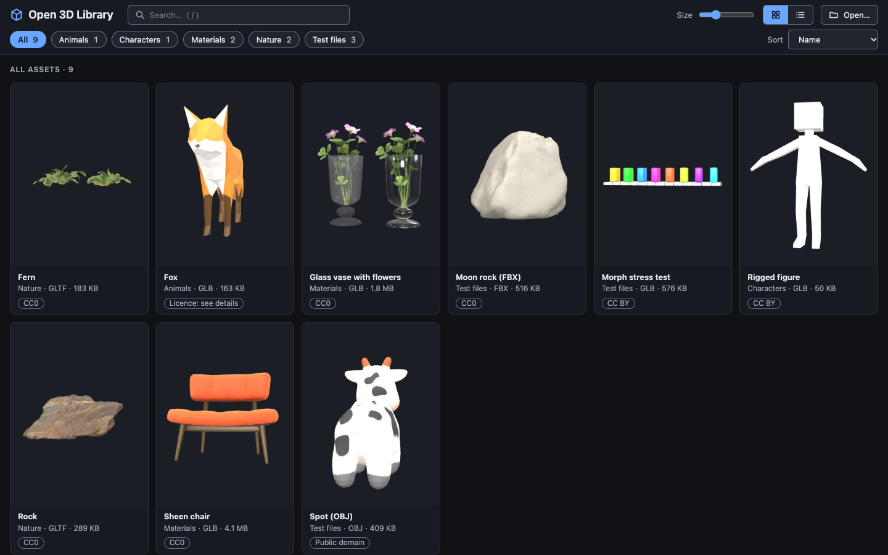
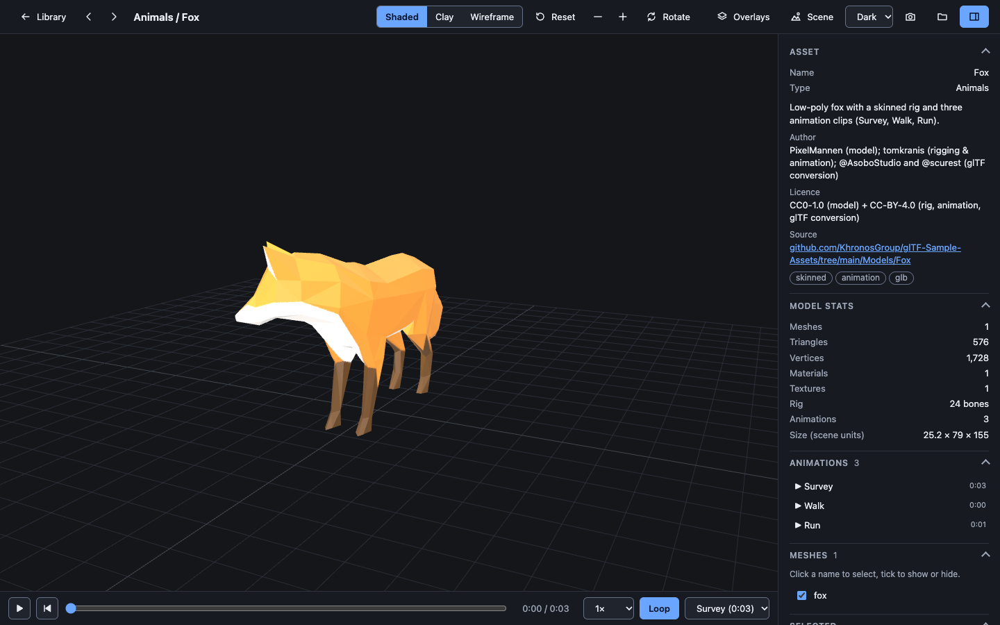
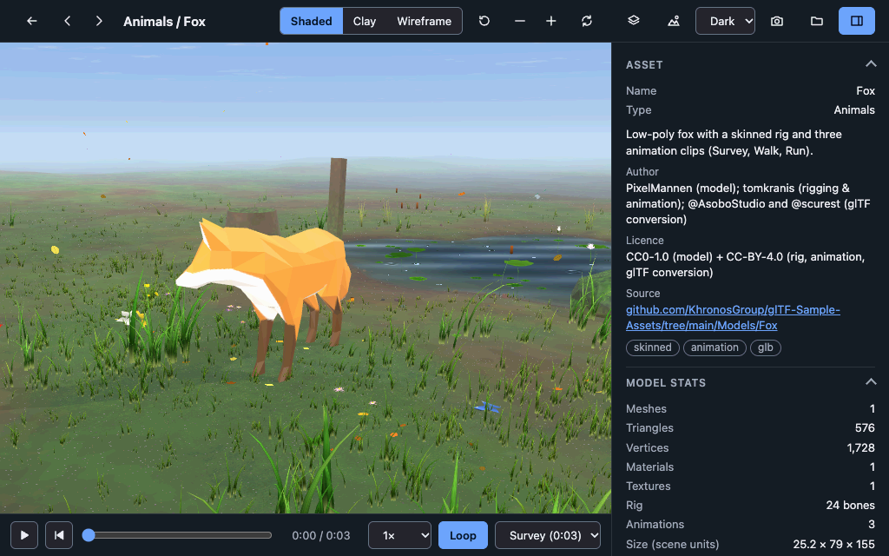

# Open 3D Library

A local-first 3D asset viewer and library for the web, built on [three.js](https://threejs.org). Open GLB/glTF, FBX and OBJ files from your disk, browse a library of example assets with licence details, inspect meshes, materials, rigs and animations, and place models in a procedural 3D meadow.

No account, no upload, no backend required: your files stay in your browser.


https://github.com/user-attachments/assets/c2a90976-ae8d-43b8-8737-642e161c9c3a




| Viewer | Procedural meadow |
|---|---|
|  |  |

## Features

- **Open your own files.** Use **Open…**, press `O`, or drag files or a whole folder onto the page. Multi-file glTF, FBX and OBJ textures are resolved by name. Files never leave your machine.
- **Formats:** GLB/glTF (PBR, skinning, morph targets, animations, three.js-supported `KHR_materials_*` extensions), FBX, OBJ + MTL, and VMD motion on a built-in mannequin. See [docs/formats.md](docs/formats.md) for details and limits.
- **Library:**
  - Search, category chips, sorting, and grid or list view.
  - Thumbnails, plus licence, author and source for every example.
- **Viewer:**
  - Display modes: shaded, clay and wireframe.
  - Grid, bounding box and bones overlays, auto-rotate and screenshots.
  - Animation playback with clip selection.
  - An inspector for meshes, materials, applied and unused textures, and files.
- **Scenes:**
  - A procedural meadow with terrain, wind-driven instanced grass and flowers, and a pond.
  - Weather and seasons, procedural wildlife and insects.
  - Painted 2D backdrops.
- **Keyboard first:**

  | Key | Action |
  |---|---|
  | `/` | Search |
  | `O` | Open file |
  | `R` | Reset view |
  | `W` / `C` | Wireframe / clay |
  | `G` / `B` / `K` | Grid / bounding box / bones |
  | `E` | Scene |
  | `I` | Inspector |
  | `[` / `]` | Previous / next asset |
  | `Space` | Play |
  | `Esc` | Back |

## Quick start

You need [Node.js](https://nodejs.org) 20 or newer.

```sh
git clone https://github.com/itsonu/open-3d-library.git
cd open-3d-library
npm ci
npm run dev
```

Open the printed URL. For a production build: `npm run build`, then `npm run preview`.

### Your own asset folder (optional)

`serve.py` (Python 3.9+, standard library only) serves the built app together with a folder of your assets and generates a catalogue for it:

```sh
npm run build
python3 serve.py --assets path/to/my-assets
```

- **Folder layout:** one sub-folder per asset, named `<type>-<name>` (for example `character-knight`), with the model and its textures inside.
- **Optional metadata:** a `meta.json` (`name`, `description`, `license`, `author`, `source`, `tags`) in a sub-folder adds details to the library.
- **Private collection:** use `--local-assets DIR` for files you must not publish. They appear with a *Local* badge and are never written into the public catalogue.
- **Network:** the server listens on `127.0.0.1` only.

## Example assets

The bundled examples come from the [Khronos glTF Sample Assets](https://github.com/KhronosGroup/glTF-Sample-Assets), [Poly Haven](https://polyhaven.com) and Keenan Crane's model repository. Each one is CC0, CC BY 4.0 or public domain. [ASSETS.md](ASSETS.md) lists the source, author, licence and required attribution for each.

## Development

```sh
npm run check      # private-file guard, unit tests, server tests
npm run test:e2e   # browser smoke tests (Playwright)
npm run catalog    # rebuild public/catalog.json after adding an example
```

[CONTRIBUTING.md](CONTRIBUTING.md) covers setup, project layout, the asset policy and how to send a change. [docs/architecture.md](docs/architecture.md) explains how the app is organised, and [docs/performance.md](docs/performance.md) has measured frame times and the benchmark method.

The repository also ships a Claude Code skill, [`.claude/skills/procedural-world-craft`](.claude/skills/procedural-world-craft/README.md), with the method, verified lessons and benchmarking protocol used to build and tune the procedural meadow.

## Licence

- **Code:** [MIT](LICENSE).
- **Vendored code** keeps its own licences; see [THIRD_PARTY_NOTICES.md](THIRD_PARTY_NOTICES.md).
- **Example assets** keep their own licences; see [ASSETS.md](ASSETS.md).

Security issues: see [SECURITY.md](SECURITY.md).
